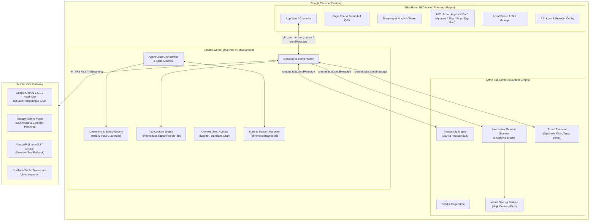
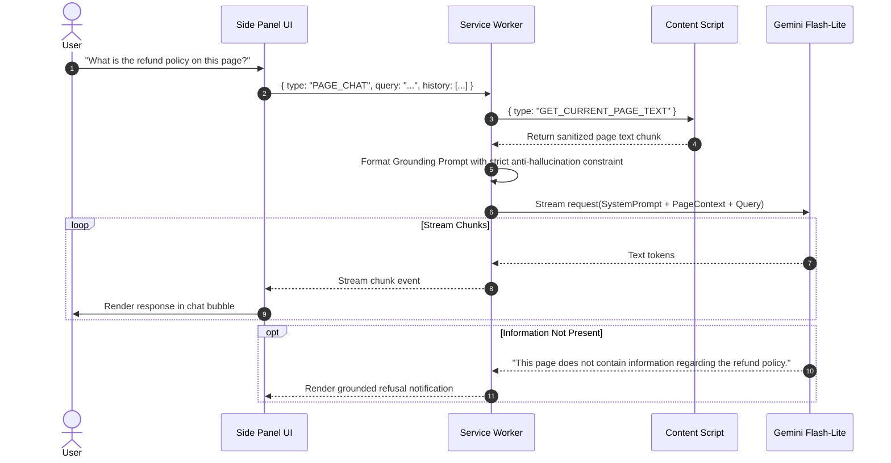
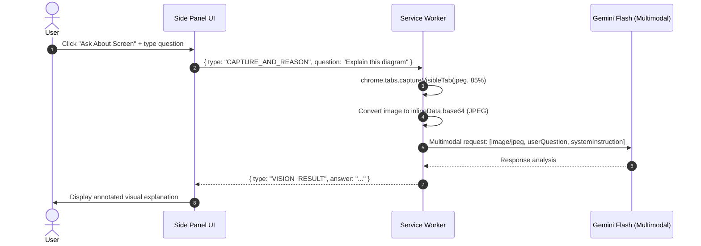
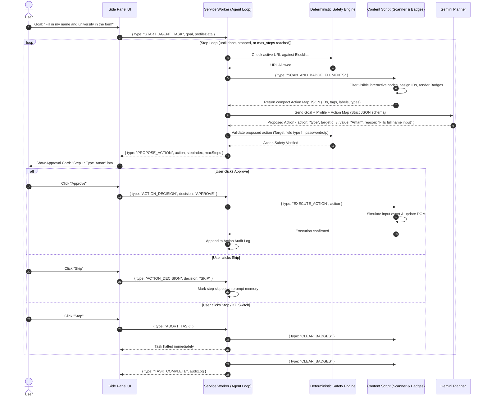
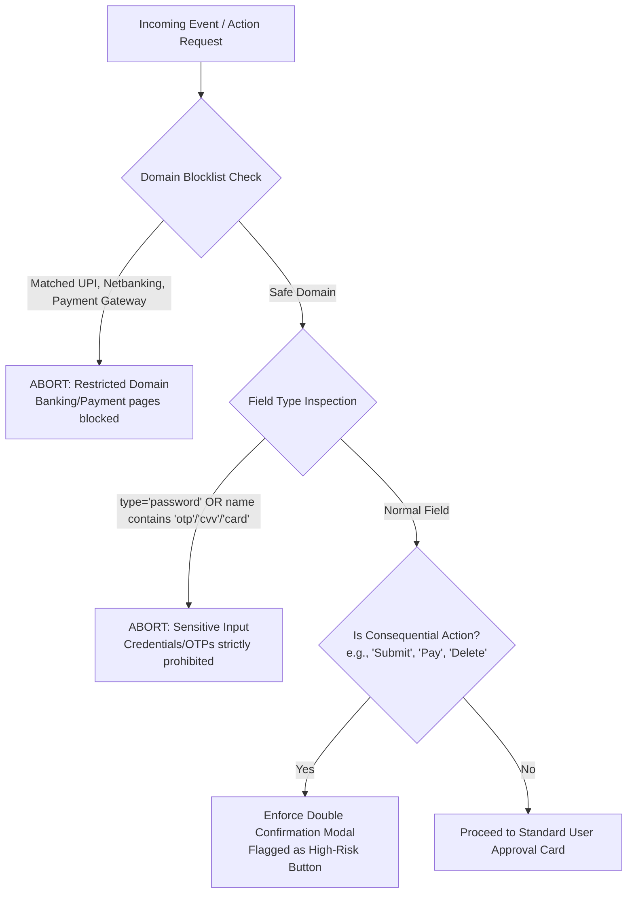
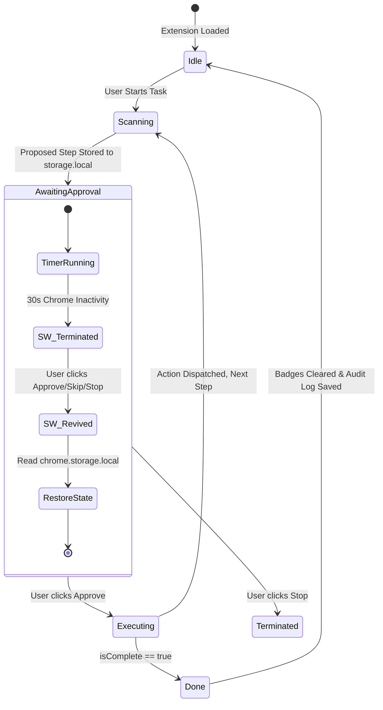
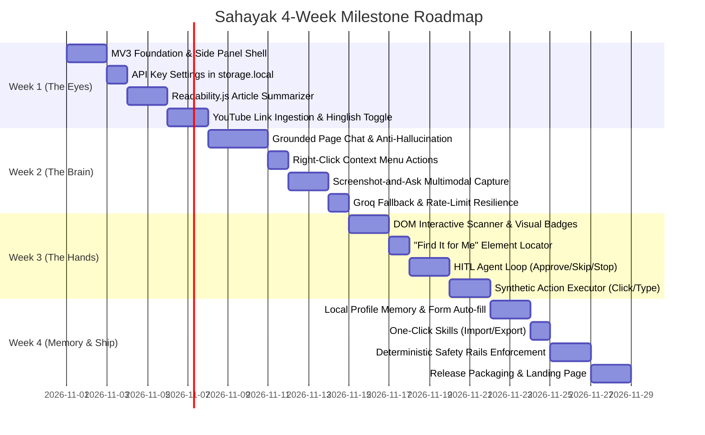

# Sahayak (सहायक) — System Architecture Document
**A Safe, Human-in-the-Loop Chrome Side-Panel Browser AI Agent**

---

## 1. Executive Summary & Architectural Philosophy

**Sahayak** is a desktop browser agent built on **Chrome Extension Manifest V3**. Unlike fully autonomous web agents that operate headlessly and present unpredictable safety risks, Sahayak adheres strictly to the **Human-in-the-Loop (HITL)** paradigm:
1. **Perceive**: Inspect and understand the active tab (DOM, text content, or visible screen).
2. **Reason**: Plan exactly **one discrete action** at a time using structured JSON contracts.
3. **Confirm**: Present the proposed action, target element, and human-readable justification to the user.
4. **Execute**: Dispatch the browser action *only* upon explicit user approval (`Approve`, `Skip`, `Stop`).
5. **Protect**: Enforce deterministic, code-level safety filters before the model or action is ever invoked.

---

## 2. System Topology & Component Architecture

The extension is partitioned into five distinct layers running across three isolated execution boundaries (Side Panel Context, Background Service Worker, and Web Page DOM Context).



---

## 3. Subsystem Breakdown & Responsibilities

### 3.1. Side Panel UI Subsystem (`src/sidepanel/`)
The user interface resides permanently in the Chrome side panel (`chrome.sidePanel`), sharing screen space with active browsing tabs.

*   **View Modes**:
    *   **Summarize Mode**: Displays clean TL;DR, 5 bullet takeaways, and actionable next steps. Supports a real-time **English ↔ Hinglish** toggle.
    *   **Page Chat Mode**: Grounded streaming conversation bound to extracted page content. Displays citations and fallback flags when questions fall outside page scope.
    *   **Screenshot & Visual Q&A Mode**: Displays the captured viewport crop with a prompt input for analyzing graphs, forms, diagrams, or visual errors.
    *   **Action Execution Panel**: Shows the current step count, max steps, action type (`click`, `type`, etc.), element target label, one-line justification, and controls (`Approve`, `Skip`, `Stop`, `Dry-run checkbox`).
    *   **Profile & Skills Manager**: Interface to configure user memory fields (education, links, background) and save or export/import one-click recipes (`.json`).
    *   **Settings Modal**: User-entered API keys (stored solely in `chrome.storage.local`). Never logged or synchronized.

### 3.2. Background Service Worker Subsystem (`src/background/`)
Under Manifest V3, the service worker is ephemeral and can terminate during idle states. All long-running agent flows must be stateless or backed by `chrome.storage.local`.

*   **`AgentLoopStateMachine`**:
    *   Tracks session ID, step index, accumulated action log, goal instruction, and execution state (`IDLE`, `SCANNING`, `AWAITING_APPROVAL`, `EXECUTING`, `COMPLETED`, `ABORTED`).
    *   Persists active state to storage on every step transition to resist SW restarts.
*   **`SafetyValidator` (Deterministic Code Filter)**:
    *   Evaluates URL schemes, domain blacklists, and input element metadata *before* calling external models and *before* dispatching actions.
*   **`TabCaptureService`**:
    *   Invokes `chrome.tabs.captureVisibleTab(null, { format: 'jpeg', quality: 85 })` to retrieve viewport base64 data.
*   **`ContextMenuHandler`**:
    *   Registers native right-click commands (`Explain this`, `Translate to Hindi`, `Draft a reply`) and routes selections to the side panel.

### 3.3. Content Script Subsystem (`src/content/`)
Injected dynamically or via declaration into the web page DOM.

*   **`ReadabilityExtractor` (`content/extractor.js`)**:
    *   Wraps `@mozilla/readability` to isolate article body text, stripping ads, navigations, sidebars, and modals.
*   **`ElementScanner` (`content/scanner.js`)**:
    *   Queries interactive elements: `button, a, input, select, textarea, [role='button'], [tabindex]:not([tabindex='-1'])`.
    *   Filters out invisible elements (`display: none`, `visibility: hidden`, `opacity: 0`, or bounding box $0 \times 0$).
    *   Assigns a deterministic, unique badge number (`data-sahayak-id="1..N"`).
    *   Injects high-contrast badge overlays directly into the page (or Shadow DOM container) to prevent stylesheet collisions.
*   **`ActionExecutor` (`content/executor.js`)**:
    *   Executes synthetic DOM events (`PointerEvent`, `FocusEvent`, `InputEvent`, `KeyboardEvent`) matching standard user interactions.
    *   Simulates realistic input behavior (e.g. setting value followed by dispatching `input` and `change` events for React/Vue reactive forms).

### 3.4. AI Gateway & Model Provider Subsystem (`src/ai/`)
Encapsulates external API communication, model fallbacks, rate limiters, and prompt construction.

*   **`ModelClient` Strategy**:
    *   **Primary Text & Light Reasoning**: `gemini-1.5-flash-8b` / `gemini-2.0-flash-lite` (low latency, high free-tier quotas).
    *   **Vision & Complex Planning**: `gemini-1.5-flash` / `gemini-2.0-flash` (screenshot input + structured schema planning).
    *   **Text Fallback**: Groq Cloud API (`llama-3.3-70b-versatile` or `mixtral-8x7b-32768`) invoked automatically on HTTP 429 / quota exhaustion.
*   **Structured Output Engine**:
    *   Enforces Gemini `responseSchema` or strict JSON schema system prompts to guarantee predictable response parsing.
*   **Retry & Exponential Backoff**:
    *   Catches HTTP 429/503 errors; waits $2^n \times 1000\text{ ms}$ up to 3 retries before switching providers.

---

## 4. End-to-End Data Flows & Sequences

### 4.1. Article & YouTube Summarization (with Hinglish Toggle)

```mermaid
sequenceDiagram
    autonumber
    actor User
    participant UI as Side Panel UI
    participant SW as Service Worker
    participant CS as Content Script
    participant LLM as Gemini Flash-Lite

    User->>UI: Click "Summarize Page" (Lang: Hinglish)
    UI->>SW: { type: "SUMMARIZE_REQUEST", lang: "hinglish" }
    
    alt Is YouTube URL (youtube.com/watch?v=...)
        SW->>SW: Extract Video ID
        SW->>LLM: Ingest YouTube Link / Metadata Prompt
    else Standard Article Page
        SW->>CS: { type: "EXTRACT_CONTENT" }
        CS->>CS: Run Mozilla Readability.js
        CS-->>SW: { title, byline, textContent, excerpt }
        SW->>LLM: Prompt(System: Summarizer + Hinglish, Content: textContent)
    end

    LLM-->>SW: Structured JSON { tldr, keyPoints[5], nextSteps[3] }
    SW-->>UI: { type: "SUMMARY_SUCCESS", data }
    UI->>User: Render TL;DR, Bullet points, Action checklist
```

---

### 4.2. Grounded Page Chat (Zero-Hallucination Policy)



---

### 4.3. Screenshot-and-Ask (Visual Reasoning)



---

### 4.4. Human-in-the-Loop Browser Action Loop

This is the central execution loop for browser automation, guaranteeing human authorization for each individual step.



---

## 5. Deterministic Safety & Privacy Engine

Model instructions ("system prompts") are insufficient on their own to prevent unwanted autonomous actions or data leaks. Sahayak implements **deterministic hard-coded safety gates** that execute prior to model ingestion and DOM manipulation.



### Safety Guardrails Matrix

| Guardrail ID | Trigger Condition | Code Enforcement Location | Action Taken |
| :--- | :--- | :--- | :--- |
| **SAFE-01** | URL matches banking/UPI (`*.onlinesbi.com`, `*paytm.com`, `*upi*`, `*checkout*`) | `background/safety.js` | Immediately terminates agent loop; suppresses DOM scraping; alerts user. |
| **SAFE-02** | Target element `type="password"`, `autocomplete="one-time-code"`, or regex `/(cvv|otp|pin|ssn)/i` | `content/scanner.js` & `background/safety.js` | Mask element from action map; model is never shown the field; typing is blocked. |
| **SAFE-03** | Button labeled `Submit`, `Pay Now`, `Confirm Order`, `Delete Account` | `background/safety.js` | UI forces a distinct high-friction secondary modal: *"Consequential action detected: do you confirm submission?"* |
| **SAFE-04** | Service Worker idle/crash | `background/state.js` | All active task states stored in `chrome.storage.local`; requires user re-confirmation upon wake. |
| **SAFE-05** | Rate Limit (HTTP 429) | `ai/gateway.js` | Exponential backoff retry $\to$ switch to Groq fallback $\to$ graceful user notification. |
| **SAFE-06** | Secret leakage | Build pipeline & `.gitignore` | API keys stored in user's browser `chrome.storage.local`. Never embedded in source. |

---

## 6. Data Contracts & JSON Schemas

### 6.1. Action Map Representation (Content Script $\to$ Background)
To prevent token bloat, the scanner extracts a lightweight, filtered representation of interactive nodes rather than feeding full DOM trees to the LLM:

```json
{
  "pageTitle": "Internship Application Form",
  "url": "https://example.com/apply",
  "elements": [
    {
      "id": 1,
      "tag": "input",
      "type": "text",
      "name": "full_name",
      "placeholder": "Enter your full name",
      "label": "Full Name",
      "currentValue": ""
    },
    {
      "id": 2,
      "tag": "input",
      "type": "email",
      "name": "user_email",
      "placeholder": "name@example.com",
      "label": "Email Address",
      "currentValue": ""
    },
    {
      "id": 3,
      "tag": "select",
      "name": "degree",
      "label": "Degree / Course",
      "options": ["B.Tech", "B.Sc", "B.Com", "Other"]
    },
    {
      "id": 4,
      "tag": "button",
      "type": "submit",
      "label": "Submit Application",
      "isConsequential": true
    }
  ]
}
```

### 6.2. LLM Next-Action Output Schema (Strict JSON)
```json
{
  "type": "object",
  "properties": {
    "action": {
      "type": "string",
      "enum": ["click", "type", "select", "scroll", "done", "error"]
    },
    "targetId": {
      "type": "integer",
      "description": "The numeric ID corresponding to the badged element on the screen"
    },
    "value": {
      "type": "string",
      "description": "Value to type or select. Null for click or scroll."
    },
    "reason": {
      "type": "string",
      "description": "One concise sentence explaining why this step is taken."
    },
    "isComplete": {
      "type": "boolean",
      "description": "True if the overall user goal has been achieved."
    }
  },
  "required": ["action", "reason", "isComplete"]
}
```

### 6.3. User Profile Memory Schema (`chrome.storage.local.profile`)
```json
{
  "personal": {
    "fullName": "Aman Sharma",
    "email": "aman@example.com",
    "phone": "+91-9876543210",
    "location": "Bengaluru, India"
  },
  "education": {
    "college": "National Institute of Technology",
    "degree": "B.Tech Computer Science",
    "graduationYear": "2026"
  },
  "professional": {
    "skills": ["JavaScript", "Python", "React", "Chrome Extensions", "Cloud"],
    "github": "https://github.com/aman",
    "linkedin": "https://linkedin.com/in/aman",
    "portfolio": "https://aman.dev"
  },
  "preferences": {
    "defaultLanguage": "hinglish",
    "preferredTone": "polite"
  }
}
```

### 6.4. Reusable Skill Recipe Schema (`skill.json`)
```json
{
  "id": "skill_internship_apply",
  "name": "Auto-Fill Internship Application",
  "description": "Maps local profile fields to visible job application inputs",
  "version": "1.0.0",
  "promptTemplate": "Use my stored personal, education, and professional profile fields to complete the application form on this page. Do not submit without my explicit approval.",
  "targetUrlPatterns": ["*://*.internshala.com/*", "*://*apply*"],
  "dryRunByDefault": false
}
```

### 6.5. Action Audit Log Entry
```json
{
  "step": 1,
  "timestamp": "2026-10-27T11:30:00.000Z",
  "action": "type",
  "targetId": 1,
  "elementDescription": "input#full_name (Full Name)",
  "value": "Aman Sharma",
  "reason": "Populates candidate full name from local profile",
  "userDecision": "APPROVED",
  "status": "SUCCESS"
}
```

---

## 7. Service Worker Lifecycle & State Persistence

In Chrome Manifest V3, background service workers are killed by the browser after ~30 seconds of inactivity. If a user spends two minutes reviewing an action card before clicking **Approve**, the worker must revive without losing context.



### Implementation Mechanism:
1. When a proposed action is sent to the UI, the service worker commits the entire snapshot to `chrome.storage.local`:
   `await chrome.storage.local.set({ activeTaskState: { sessionId, step, goal, proposedAction } });`
2. When the user interacts with the approval card in the side panel, the UI sends a message to the worker:
   `chrome.runtime.sendMessage({ type: "ACTION_DECISION", decision: "APPROVE" })`.
3. If the worker had gone to sleep, the incoming runtime message wakes it up automatically.
4. The worker restores `activeTaskState` from storage before dispatching the execution command to the content script.

---

## 8. Concrete Directory & Module Structure

```text
sahayak/
├── manifest.json                  # Manifest V3 configuration & permission definitions
├── package.json                   # Build tools, scripts & dependencies
├── vite.config.js                 # Bundler config (or standard webpack)
├── assets/                        # Icons, badges, visual branding
│   ├── icon-16.png
│   ├── icon-48.png
│   └── icon-128.png
├── src/
│   ├── background/                # Background Service Worker
│   │   ├── index.js               # Event dispatch & life-cycle initialization
│   │   ├── agentLoop.js           # HITL step-by-step orchestrator & state machine
│   │   ├── safety.js              # URL blocklist & sensitive input validators
│   │   ├── capture.js             # chrome.tabs.captureVisibleTab wrapper
│   │   └── contextMenus.js        # Right-click context menu registry
│   │
│   ├── sidepanel/                 # Chrome Side Panel UI
│   │   ├── index.html             # Main side panel markup
│   │   ├── sidepanel.js           # View controller & message listener
│   │   ├── sidepanel.css          # Styling & badge preview styles
│   │   └── components/
│   │       ├── SummaryView.js     # TL;DR, 5 points & Hinglish switcher
│   │       ├── ChatView.js        # Grounded page chat UI
│   │       ├── ActionApprovalCard.js # Step action, reason & HITL buttons
│   │       ├── ScreenshotView.js  # Viewport image & query input
│   │       ├── ProfileManager.js  # Local memory form & storage binding
│   │       └── SettingsModal.js   # API key configuration
│   │
│   ├── content/                   # Content Scripts (Runs in Web Page Context)
│   │   ├── index.js               # Message router inside page DOM
│   │   ├── extractor.js           # Mozilla Readability.js wrapper
│   │   ├── scanner.js             # Interactive element query & badging
│   │   ├── badges.css             # High-contrast number badge styles
│   │   └── executor.js            # Synthetic click, type, select DOM drivers
│   │
│   ├── ai/                        # Model & Inference Subsystem
│   │   ├── gateway.js             # Unified client handling Gemini & Groq fallback
│   │   ├── geminiClient.js        # Gemini Flash-Lite & Flash multimodal SDK calls
│   │   ├── groqClient.js          # Free-tier Groq API integration
│   │   ├── prompts.js             # Grounded system prompts & Hinglish templates
│   │   └── schemas.js             # Strict JSON schemas for model decisions
│   │
│   └── common/                    # Shared Utilities & Storage
│       ├── constants.js           # Message types, storage keys, safety regexes
│       ├── storage.js             # Typed helpers for chrome.storage.local
│       └── logger.js              # Action audit log recorder
│
├── docs/                          # Project Documentation
│   ├── ProblemStatement.md        # Cohort problem statement
│   └── architecture.md            # This detailed technical architecture
└── README.md                      # Installation, setup & usage guide
```

---

## 9. Manifest V3 Configuration & Least Privilege

The `manifest.json` specifies only the essential permissions required by Sahayak's functional criteria:

```json
{
  "manifest_version": 3,
  "name": "Sahayak - AI Browser Assistant",
  "version": "1.0.0",
  "description": "Safe, human-in-the-loop Chrome side-panel AI agent for reading, understanding, and acting on web pages.",
  "icons": {
    "16": "assets/icon-16.png",
    "48": "assets/icon-48.png",
    "128": "assets/icon-128.png"
  },
  "background": {
    "service_worker": "src/background/index.js",
    "type": "module"
  },
  "side_panel": {
    "default_path": "src/sidepanel/index.html"
  },
  "action": {
    "default_title": "Open Sahayak Side Panel"
  },
  "permissions": [
    "sidePanel",
    "storage",
    "activeTab",
    "scripting",
    "contextMenus"
  ],
  "host_permissions": [
    "https://generativelanguage.googleapis.com/*",
    "https://api.groq.com/*"
  ],
  "web_accessible_resources": [
    {
      "resources": ["src/content/badges.css", "assets/*"],
      "matches": ["<all_urls>"]
    }
  ]
}
```

---

## 10. Phased 4-Week Implementation Plan

Aligning with the four-week milestones specified in the Problem Statement:



### Acceptance & Verification Checklist:
*   [ ] **Week 1 Acceptance**: Unpacked extension opens in side panel; Gemini API key saved; articles distilled into structured TL;DR + 5 points; Hinglish output working.
*   [ ] **Week 2 Acceptance**: Page chat refuses out-of-context questions; right-click context menu works; screenshot questions parse diagrams; HTTP 429 fails over to Groq.
*   [ ] **Week 3 Acceptance**: Numbers badge visible on inputs and buttons; agent plans single next step in JSON; browser acts only after user clicks "Approve"; dry-run highlights without executing.
*   [ ] **Week 4 Acceptance**: Local profile fields auto-fill test applications; banking domains and password inputs strictly blocked; installable ZIP packaged for GitHub Releases.

