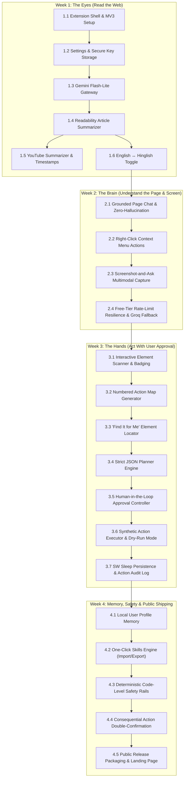
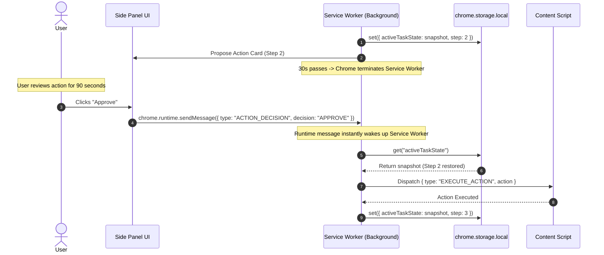

# Sahayak (सहायक) — Phase-Wise Implementation Plan
**A Safe, Human-in-the-Loop Chrome Side-Panel Browser AI Agent**

---

## 1. Executive Summary & Implementation Roadmap

This document defines the comprehensive, step-by-step technical implementation plan for **Sahayak**, a Chrome extension built on **Manifest V3**. The plan translates the requirements from [docs/ProblemStatement.md](file:///c:/Users/AMAN/MyGoogleProjects/docs/ProblemStatement.md) and the technical design from [docs/architecture.md](file:///c:/Users/AMAN/MyGoogleProjects/docs/architecture.md) into concrete, vertical engineering slices across a **4-Week Milestone Schedule**.

### Core Tenets of the Build:
1. **Vertical Slice Development**: Every feature slice delivers an end-to-end working capability (UI $\to$ Service Worker $\to$ Content Script / AI $\to$ DOM) tested on real webpages before advancing.
2. **Human-in-the-Loop (HITL) by Design**: The browser agent is structurally incapable of autonomous execution; every single DOM action requires user confirmation (`Approve`, `Skip`, `Stop`).
3. **Deterministic Safety Guardrails**: Hardcoded code filters execute prior to any model reasoning or action execution, strictly blocking sensitive domains (banking, UPI, checkout) and sensitive input fields (passwords, OTPs, CVVs).
4. **Service Worker Sleep Resilience**: All long-running state machine snapshots persist to `chrome.storage.local`, ensuring 100% recovery across MV3 background service worker idle terminations (~30s).
5. **Zero-Cost / Free-Tier Optimization**: Powered primarily by Google Gemini 1.5/2.0 Flash-Lite and Flash, backed by Groq (Llama 3.3 / Mixtral) with automatic rate-limit backoff handling.

---

## 2. System Architecture & Directory Specification

The project follows a modular structure decoupling UI presentation, background orchestration, in-page DOM manipulation, and AI inference gateways:

```text
sahayak/
├── manifest.json                  # Chrome Extension Manifest V3 configuration
├── package.json                   # Dependencies, build scripts (Vite / Rollup)
├── vite.config.js                 # Multi-entry build bundler for MV3
├── assets/                        # Icons, high-contrast badges & branding
│   ├── icon-16.png
│   ├── icon-48.png
│   ├── icon-128.png
│   └── test-avatar.png
├── src/
│   ├── background/                # Background Service Worker Subsystem
│   │   ├── index.js               # Service Worker entry & event listeners
│   │   ├── agentLoop.js           # HITL step-by-step orchestrator & state machine
│   │   ├── safety.js              # Deterministic URL blocklist & input guards
│   │   ├── capture.js             # chrome.tabs.captureVisibleTab wrapper
│   │   ├── contextMenus.js        # Right-click context menu dispatcher
│   │   └── state.js               # Storage-backed state hydration/persistence
│   │
│   ├── sidepanel/                 # Chrome Side Panel UI Subsystem
│   │   ├── index.html             # Master HTML frame for side panel
│   │   ├── sidepanel.js           # Controller, event bus & message router
│   │   ├── sidepanel.css          # Modern dark/light responsive styling
│   │   └── components/
│   │       ├── Header.js          # Status pill, active tab badge, lang toggle
│   │       ├── SummaryView.js     # Article/YouTube TL;DR, 5 points, next steps
│   │       ├── ChatView.js        # Grounded Q&A conversation & streaming bubbles
│   │       ├── ScreenshotView.js  # Viewport visual query interface & image crop
│   │       ├── ActionApprovalCard.js # Step details, reasoning & HITL control buttons
│   │       ├── ProfileManager.js  # Local user memory editor (education, links)
│   │       ├── SkillsManager.js   # One-click recipes import/export & runner
│   │       ├── AuditLogView.js    # Collapsible timeline of executed actions
│   │       └── SettingsModal.js   # API keys configuration & provider health
│   │
│   ├── content/                   # Content Scripts Subsystem (Page Context)
│   │   ├── index.js               # Content script entry & message router
│   │   ├── extractor.js           # Mozilla Readability.js article content stripper
│   │   ├── scanner.js             # Interactive element query, filtering & numbering
│   │   ├── badges.css             # High-contrast, non-colliding numeric badge pins
│   │   ├── executor.js            # Synthetic event driver (click, type, select, scroll)
│   │   └── highlighter.js         # Dry-run bounding box glow & focus scroll
│   │
│   ├── ai/                        # Model & AI Gateway Subsystem
│   │   ├── gateway.js             # Unified client handling retries, fallbacks & schemas
│   │   ├── geminiClient.js        # Gemini REST/SDK integration (Flash-Lite & Flash)
│   │   ├── groqClient.js          # Groq Cloud API fallback (Llama-3.3-70b / Mixtral)
│   │   ├── prompts.js             # Grounded system prompts, Hinglish few-shots
│   │   └── schemas.js             # Strict JSON schemas for agent decisions
│   │
│   └── common/                    # Shared Modules & Cross-Boundary Helpers
│       ├── constants.js           # Message types, storage keys, action enums
│       ├── storage.js             # Strongly-typed chrome.storage.local abstractions
│       ├── logger.js              # In-memory and persisted action audit logger
│       └── utils.js               # URL parsers, sanitizers & string helpers
│
├── tests/                         # Test Suites & Fixtures
│   ├── fixtures/
│   │   ├── article.html           # Mock blog post for Readability testing
│   │   ├── practice-form.html     # Multi-step job application form
│   │   ├── banking-mock.html      # Restricted checkout page fixture
│   │   └── shopping-mock.html     # Search & filter ecommerce mock
│   └── unit/
│       ├── safety.test.js         # Deterministic safety rule assertions
│       ├── scanner.test.js        # Element detection and badge assignment tests
│       └── prompts.test.js        # Schema validation & formatting tests
│
├── docs/                          # Architecture & Specifications
│   ├── ProblemStatement.md        # Cohort problem statement
│   ├── architecture.md            # Technical architecture specification
│   └── implementation-plan.md     # This comprehensive milestone plan
└── README.md                      # Setup guide, installation and usage manual
```

---

## 3. High-Level Milestone Gantt & Dependency Graph



---

## 4. Phase-Wise Detailed Implementation Specification

---

### Phase 1: Week 1 — The Eyes: Read the Web

**Primary Objective**: Build the Manifest V3 extension backbone, establish persistent side-panel rendering, connect to the Gemini API, and provide instant structured article and YouTube summaries with real-time English $\leftrightarrow$ Hinglish translation.

#### Step 1.1: Extension Scaffolding & Manifest V3 Configuration
*   **Target Files**:
    *   `manifest.json`
    *   `package.json`
    *   `vite.config.js`
    *   `assets/icon-16.png`, `assets/icon-48.png`, `assets/icon-128.png`
*   **Tasks & Specifications**:
    *   Configure `manifest_version: 3` with permissions: `sidePanel`, `storage`, `activeTab`, `scripting`, `contextMenus`.
    *   Set `host_permissions` strictly for `https://generativelanguage.googleapis.com/*` and `https://api.groq.com/*`.
    *   Define `side_panel: { "default_path": "src/sidepanel/index.html" }` and action click to open side panel:
        ```javascript
        chrome.sidePanel.setPanelBehavior({ openPanelOnActionClick: true });
        ```
    *   Setup `vite.config.js` to bundle multiple HTML entries and output standard ES modules for Chrome extension unpacked loading.

#### Step 1.2: Settings Module & Secure Local Storage
*   **Target Files**:
    *   `src/sidepanel/components/SettingsModal.js`
    *   `src/common/storage.js`
    *   `src/common/constants.js`
*   **Tasks & Specifications**:
    *   Create a clean, accessible Settings Modal inside the side panel for entering the Gemini API key (and optional Groq API key).
    *   Implement typed helpers in `storage.js`:
        *   `saveApiKeys({ geminiKey, groqKey })`
        *   `getApiKeys()`
        *   `clearApiKeys()`
    *   Store keys strictly in `chrome.storage.local`. Ensure keys are never stored in `chrome.storage.sync`, never hardcoded, and excluded from source control.
    *   Add connection validation ("Test API Connection" button) that makes a ping request to `https://generativelanguage.googleapis.com/v1beta/models` using the key.

#### Step 1.3: Gemini API Client & Prompt Infrastructure
*   **Target Files**:
    *   `src/ai/geminiClient.js`
    *   `src/ai/prompts.js`
    *   `src/ai/schemas.js`
*   **Tasks & Specifications**:
    *   Create `geminiClient.js` using native `fetch` against the Gemini v1beta REST API:
        *   Model: `gemini-1.5-flash-8b` / `gemini-2.0-flash-lite` (low latency, high free-tier quotas).
        *   Endpoint: `https://generativelanguage.googleapis.com/v1beta/models/{model}:generateContent?key={apiKey}`
    *   Implement structured JSON responses via `generationConfig.responseMimeType: "application/json"`.
    *   Define error normalization for HTTP 400 (bad key), HTTP 429 (rate quota), and HTTP 503 (service unavailable).

#### Step 1.4: Mozilla Readability.js Article Extraction Engine
*   **Target Files**:
    *   `src/content/extractor.js`
    *   `src/content/index.js`
    *   `src/sidepanel/components/SummaryView.js`
*   **Tasks & Specifications**:
    *   Integrate `@mozilla/readability` in `src/content/extractor.js`.
    *   Listen for `{ type: "EXTRACT_ARTICLE" }` in content script:
        ```javascript
        const documentClone = document.cloneNode(true);
        const article = new Readability(documentClone).parse();
        // Returns: { title, byline, textContent, excerpt, length }
        ```
    *   Send sanitized text content to background service worker.
    *   Prompt Gemini to return a structured JSON summary matching the cohort specification:
        ```json
        {
          "title": "Article Title",
          "tldr": "One crisp sentence explaining the core finding.",
          "keyPoints": [
            "Point 1...",
            "Point 2...",
            "Point 3...",
            "Point 4...",
            "Point 5..."
          ],
          "nextSteps": [
            "Actionable takeaway 1",
            "Actionable takeaway 2"
          ]
        }
        ```
    *   Render summary in `SummaryView.js` with clear typography, badge icons, and a copy-to-clipboard button.

#### Step 1.5: Public YouTube Video Summarization & Timestamps
*   **Target Files**:
    *   `src/background/index.js`
    *   `src/sidepanel/components/SummaryView.js`
    *   `src/common/utils.js`
*   **Tasks & Specifications**:
    *   Detect YouTube URLs via regex: `/(?:youtube\.com\/watch\?v=|youtu\.be\/)([a-zA-Z0-9_-]{11})/`.
    *   Extract video title and metadata from active tab DOM or public oEmbed / player context.
    *   Pass the YouTube URL directly to Gemini with prompt requesting key takeaways and chapter-style notes with timestamp markers (`MM:SS`).
    *   Render timestamps in `SummaryView.js` as clickable links that message the content script to execute `videoElement.currentTime = seconds; videoElement.play();`.

#### Step 1.6: Dynamic English $\leftrightarrow$ Hinglish Language Switcher
*   **Target Files**:
    *   `src/sidepanel/components/Header.js`
    *   `src/ai/prompts.js`
*   **Tasks & Specifications**:
    *   Add a prominent segmented control `[ English | Hinglish ]` in the side panel header.
    *   Store preference in `chrome.storage.local` under `preferredLanguage`.
    *   Inject Hinglish few-shot instructions into system prompt:
        *   *Guidelines*: Use natural conversational Hindi written in Latin script (e.g., *"Yeh article explain karta hai ki transformer models kaise kaam karte hain..."*), retaining technical terms in English.
    *   Provide an instant re-translate button on any active summary without re-scraping the page.

#### Phase 1 Verification & Acceptance Criteria:
*   [ ] Extension loads via `chrome://extensions` $\to$ **Load unpacked** without manifest or CSP warnings.
*   [ ] Clicking the extension icon opens the side panel reliably.
*   [ ] User can enter and validate their Gemini API key; invalid keys display friendly errors.
*   [ ] On a news/blog article, clicking **Summarise** extracts clean text and displays:
    *   1-line TL;DR
    *   Exactly 5 bullet points
    *   Actionable next steps
*   [ ] On a public YouTube video, clicking **Summarise** generates chapter notes with clickable timestamps.
*   [ ] Toggling to **Hinglish** renders accurate, readable conversational Hinglish text.

---

### Phase 2: Week 2 — The Brain: Understand the Page and the Screen

**Primary Objective**: Transform Sahayak into a grounded conversational assistant that answers queries strictly using page context, responds to right-click text actions, visually reasons over screen captures, and gracefully handles API quotas.

#### Step 2.1: Grounded Page Chat (Anti-Hallucination Engine)
*   **Target Files**:
    *   `src/sidepanel/components/ChatView.js`
    *   `src/background/index.js`
    *   `src/ai/prompts.js`
*   **Tasks & Specifications**:
    *   Implement chat interface with user input, scrollable message history, token streaming, and markdown formatting.
    *   When the user submits a question:
        1. Query content script for active page text chunk (up to 12,000 words).
        2. Construct strict grounding prompt:
           ```text
           You are Sahayak Page Chat. You must answer the user's question ONLY using the provided page context.
           If the answer cannot be found in the context, respond strictly with:
           "This page does not contain information about [topic]."
           Do not extrapolate, assume, or invent facts outside the text.
           ```
        3. Stream response tokens via Server-Sent Events (SSE) or Gemini streaming endpoint (`streamGenerateContent`).
    *   Maintain active session conversation history in memory and allow the user to clear chat at any time.

#### Step 2.2: Right-Click Context Menu Actions
*   **Target Files**:
    *   `src/background/contextMenus.js`
    *   `src/sidepanel/sidepanel.js`
*   **Tasks & Specifications**:
    *   Register context menus in `background/contextMenus.js` on `runtime.onInstalled`:
        ```javascript
        chrome.contextMenus.create({ id: "sahayak_explain", title: "Sahayak: Explain this", contexts: ["selection"] });
        chrome.contextMenus.create({ id: "sahayak_translate", title: "Sahayak: Translate to Hindi", contexts: ["selection"] });
        chrome.contextMenus.create({ id: "sahayak_reply", title: "Sahayak: Draft a reply", contexts: ["selection"] });
        ```
    *   Listen to `chrome.contextMenus.onClicked`:
        1. Capture `info.selectionText`.
        2. Ensure side panel is opened via `chrome.sidePanel.open({ tabId: tab.id })`.
        3. Dispatch selected text and task type (`EXPLAIN`, `TRANSLATE`, `DRAFT_REPLY`) to the side panel view.
        4. Render the resulting explanation, Hindi translation, or professional reply draft with an instant **Copy to Clipboard** button.

#### Step 2.3: Screenshot-and-Ask (Multimodal Visual Reasoning)
*   **Target Files**:
    *   `src/background/capture.js`
    *   `src/sidepanel/components/ScreenshotView.js`
    *   `src/ai/geminiClient.js`
*   **Tasks & Specifications**:
    *   Implement `capture.js` calling:
        ```javascript
        chrome.tabs.captureVisibleTab(null, { format: 'jpeg', quality: 85 });
        ```
    *   In `ScreenshotView.js`, display the captured viewport thumbnail with prompt input (e.g., *"Explain this bar chart"*, *"What does this error message mean?"*).
    *   Send multimodal payload to `gemini-1.5-flash` / `gemini-2.0-flash` with:
        *   `inlineData: { mimeType: "image/jpeg", data: base64Data }`
        *   `text: userQuestion`
    *   Render visual explanation with bulleted breakdowns of visual elements, chart axes, error codes, and form instructions.

#### Step 2.4: Free-Tier Rate-Limit Resilience & Groq Fallback
*   **Target Files**:
    *   `src/ai/gateway.js`
    *   `src/ai/groqClient.js`
*   **Tasks & Specifications**:
    *   Build `gateway.js` as the unified dispatch hub for all AI queries.
    *   Implement exponential backoff retry:
        *   On HTTP 429 / 503: wait $1000\text{ ms} \times 2^{\text{attempt}}$ (max 3 retries).
    *   If Gemini quota remains exhausted and the task is text-only (Summarize, Page Chat, Explain, Translate):
        *   Automatically failover to Groq Cloud API using `llama-3.3-70b-versatile` or `mixtral-8x7b-32768`.
        *   Display a subtle non-intrusive status pill in UI: `Using Groq Fallback (Free Tier)`.
    *   If all providers fail, present a clear human-readable recovery guide (e.g., *"API rate limit exceeded. Please wait 60 seconds or update your key in Settings"*).

#### Phase 2 Verification & Acceptance Criteria:
*   [ ] Page Chat accurately answers questions grounded in the article body.
*   [ ] Page Chat explicitly refuses to answer when information is absent from the page (anti-hallucination verified).
*   [ ] Selecting text on any webpage, right-clicking, and selecting **Explain this** routes into the side panel and displays a clear explanation.
*   [ ] **Draft a reply** creates a professional context-sensitive draft from selected emails/messages.
*   [ ] **Screenshot-and-Ask** captures the visible tab, sends the JPEG to Gemini Flash, and returns accurate explanations for charts, diagrams, or visual errors.
*   [ ] Simulated HTTP 429 triggers exponential backoff, succeeds via Groq fallback, and never crashes the extension.

---

### Phase 3: Week 3 — The Hands: Act With User Approval

**Primary Objective**: Give Sahayak the ability to inspect interactive page elements, construct compact action maps, propose single-step actions via strict JSON, and execute browser actions *only* upon explicit human authorization.

#### Step 3.1: Interactive Element Scanner & High-Contrast Badging
*   **Target Files**:
    *   `src/content/scanner.js`
    *   `src/content/badges.css`
*   **Tasks & Specifications**:
    *   Query all potentially interactive DOM nodes:
        ```javascript
        const SELECTOR = "button, a, input, select, textarea, [role='button'], [role='link'], [role='checkbox'], [tabindex]:not([tabindex='-1'])";
        ```
    *   Apply rigorous visibility filters:
        *   Check `offsetWidth > 0 && offsetHeight > 0`.
        *   Verify `getComputedStyle(el).visibility !== 'hidden'` and `display !== 'none'`.
        *   Ensure bounding client rect is within or near the active viewport.
    *   Assign each visible element an ephemeral numeric index (`data-sahayak-id="1..N"`).
    *   Inject high-contrast overlay pins (`badges.css`) displaying the numeric ID directly at the top-left corner of each element:
        *   Style: Yellow background `#FACC15`, bold black text `#000000`, 2px shadow, `z-index: 2147483647`.
        *   Mount badges inside an isolated container (or Shadow DOM root) to prevent breaking website layouts.
    *   Implement `clearBadges()` to cleanly strip all pins when tasks end or stop.

#### Step 3.2: Compact Numbered Action Map Generator
*   **Target Files**:
    *   `src/content/scanner.js`
    *   `src/background/agentLoop.js`
*   **Tasks & Specifications**:
    *   Serialize interactive elements into a lightweight JSON payload (omitting verbose HTML trees to conserve LLM tokens):
        ```json
        {
          "pageTitle": "Job Application",
          "url": "https://example.com/apply",
          "elements": [
            { "id": 1, "tag": "input", "type": "text", "name": "fullName", "label": "Full Name", "currentValue": "" },
            { "id": 2, "tag": "input", "type": "email", "name": "email", "label": "Email Address", "currentValue": "" },
            { "id": 3, "tag": "select", "name": "experience", "label": "Years of Experience", "options": ["0-1", "2-4", "5+"] },
            { "id": 4, "tag": "button", "type": "button", "label": "Next Step", "isConsequential": false }
          ]
        }
        ```
    *   Extract element labels using: `<label for="...">`, parent `<label>`, `aria-label`, `placeholder`, `title`, or inner text.

#### Step 3.3: "Find It for Me" Element Locator
*   **Target Files**:
    *   `src/sidepanel/components/ChatView.js`
    *   `src/content/highlighter.js`
*   **Tasks & Specifications**:
    *   Allow the user to ask navigational queries (e.g., *"Where do I upload my resume?"*, *"Find the unsubscribe button"*).
    *   Model resolves the query against the Action Map and returns the target ID in strict JSON:
        ```json
        { "targetId": 7, "reason": "Element #7 is an input labeled 'Upload Resume (PDF)'" }
        ```
    *   Content script scrolls the target element into view (`scrollIntoView({ behavior: 'smooth', block: 'center' })`) and pulses a high-visibility glowing outline (`highlighter.js`) without executing any action.

#### Step 3.4: Strict JSON Agent Planning Engine
*   **Target Files**:
    *   `src/background/agentLoop.js`
    *   `src/ai/prompts.js`
    *   `src/ai/schemas.js`
*   **Tasks & Specifications**:
    *   Construct the one-step planning prompt with strict schema enforcement:
        ```json
        {
          "type": "object",
          "properties": {
            "action": { "type": "string", "enum": ["click", "type", "select", "scroll", "done", "error"] },
            "targetId": { "type": "integer" },
            "value": { "type": "string" },
            "reason": { "type": "string" },
            "isComplete": { "type": "boolean" }
          },
          "required": ["action", "reason", "isComplete"]
        }
        ```
    *   Enforce that the model outputs **exactly one discrete action per turn**.
    *   Reject and re-prompt if output contains markdown code fences, malformed JSON, or references non-existent element IDs.

#### Step 3.5: Human-in-the-Loop Approval Controller & UI
*   **Target Files**:
    *   `src/sidepanel/components/ActionApprovalCard.js`
    *   `src/background/agentLoop.js`
*   **Tasks & Specifications**:
    *   Create the approval interface in the side panel displaying:
        *   Current step indicator (`Step 2 of 10`)
        *   Action badge (`TYPE`, `CLICK`, `SELECT`, `SCROLL`)
        *   Target description (`Element #1: Full Name input`)
        *   Input value preview (`"Aman Sharma"`)
        *   One-line rationale (`"Fills candidate full name from local profile"`)
        *   Action buttons:
            *   `Approve (Enter)`: Dispatches execution to content script.
            *   `Skip`: Bypasses current step; prompts model for alternate step.
            *   `Stop (Esc)`: Immediate kill switch; halts loop and cleans up badges.
            *   `Dry-run checkbox`: Highlights target on page without clicking or typing.
    *   Enforce hard ceiling: maximum 10 steps per task session (configurable in settings).

#### Step 3.6: Synthetic Action Executor Subsystem
*   **Target Files**:
    *   `src/content/executor.js`
*   **Tasks & Specifications**:
    *   Execute synthetic browser actions matching realistic user interaction:
        *   `click`:
            ```javascript
            target.scrollIntoView({ behavior: 'smooth', block: 'center' });
            target.dispatchEvent(new MouseEvent('mouseover', { bubbles: true }));
            target.dispatchEvent(new MouseEvent('mousedown', { bubbles: true }));
            target.focus();
            target.dispatchEvent(new MouseEvent('mouseup', { bubbles: true }));
            target.click();
            ```
        *   `type`:
            ```javascript
            target.focus();
            target.value = value;
            target.dispatchEvent(new Event('input', { bubbles: true }));
            target.dispatchEvent(new Event('change', { bubbles: true }));
            ```
        *   `select`: Set `selectedIndex` or match option text, followed by `change` event.
        *   `scroll`: `window.scrollBy({ top: 500, behavior: 'smooth' })`.
    *   Return execution confirmation `{ success: true, timestamp }` back to service worker.

#### Step 3.7: Service Worker Sleep-Resilience & Action Audit Log
*   **Target Files**:
    *   `src/background/state.js`
    *   `src/common/logger.js`
    *   `src/sidepanel/components/AuditLogView.js`
*   **Tasks & Specifications**:
    *   Before awaiting user decision on an action card, commit entire state snapshot to `chrome.storage.local`:
        ```javascript
        await chrome.storage.local.set({
          activeTaskState: {
            sessionId,
            stepIndex,
            maxSteps,
            goal,
            proposedAction,
            status: "AWAITING_APPROVAL"
          }
        });
        ```
    *   When the user clicks `Approve`, the runtime message wakes the service worker; `state.js` rehydrates `activeTaskState` seamlessly.
    *   Append each step outcome to an immutable audit log (`logger.js`).
    *   Render collapsible audit timeline in `AuditLogView.js` with options to view timestamps, element selectors, and export log as JSON.

#### Phase 3 Verification & Acceptance Criteria:
*   [ ] Content script scans page and overlays visible, non-overlapping numbered badge pins over all interactive elements.
*   [ ] "Find It for Me" correctly pinpoints target elements (e.g., "Where is the submit button?") and smoothly scrolls to it.
*   [ ] Model proposes exactly one action at a time in strict validated JSON.
*   [ ] **Zero autonomous actions**: Browser executes nothing until user clicks `Approve`.
*   [ ] Clicking `Skip` asks the model for an alternative path; clicking `Stop` halts the loop instantly.
*   [ ] Dry-run mode visibly outlines the intended target element without modifying values or triggering clicks.
*   [ ] Service worker can be manually terminated in `chrome://serviceworker-internals`, and clicking `Approve` resumes the task without data loss.
*   [ ] Complete at least 2 practice tasks (multi-step form fill, store search & filter).

---

### Phase 4: Week 4 — Memory, Safety, and Shipping

**Primary Objective**: Equip Sahayak with local profile memory, reusable one-click skills, deterministic safety guards against sensitive pages/inputs, consequential action protections, and complete release packaging.

#### Step 4.1: Local Profile Memory & Form Auto-fill Integration
*   **Target Files**:
    *   `src/sidepanel/components/ProfileManager.js`
    *   `src/common/storage.js`
    *   `src/background/agentLoop.js`
*   **Tasks & Specifications**:
    *   Build `ProfileManager.js` UI allowing users to manage structured profile fields:
        *   *Personal*: Full Name, Email, Phone, Location.
        *   *Education*: College/University, Degree, Graduation Year, GPA.
        *   *Professional*: Skills (comma-separated tags), GitHub URL, LinkedIn URL, Portfolio.
        *   *Preferences*: Default Language (English/Hinglish), Preferred Tone (Polite/Formal/Concise).
    *   Store data strictly in `chrome.storage.local.profile`.
    *   Inject profile context into the Agent Loop prompt when users trigger form-filling tasks, enabling automatic field matching to candidate details.

#### Step 4.2: One-Click Skills Engine (Prompt Recipes & Import/Export)
*   **Target Files**:
    *   `src/sidepanel/components/SkillsManager.js`
    *   `src/common/storage.js`
*   **Tasks & Specifications**:
    *   Implement modular skills engine for saving recurring prompt recipes:
        *   Pre-bundled skills:
            1. *"Exam Revision Notes"*: Distill active academic page into key definitions, formulas, and Q&A.
            2. *"Explain in Hinglish"*: Summarize active page in student-friendly Hinglish.
            3. *"Professional Reply"*: Generate a polite, structured email reply based on selected text.
            4. *"Fill Application From Profile"*: Map local profile to form fields without submitting.
    *   Allow creating custom skills with name, description, prompt template, and optional URL regex.
    *   Provide **Export Skills (.json)** and **Import Skills (.json)** buttons for community sharing.

#### Step 4.3: Deterministic Code-Level Safety Guardrails
*   **Target Files**:
    *   `src/background/safety.js`
    *   `src/content/scanner.js`
*   **Tasks & Specifications**:
    *   Implement non-bypassable code checks running *before* calling AI models and *before* dispatching DOM actions:
        1. **Domain Blocklist (SAFE-01)**:
           ```javascript
           const BLOCKED_DOMAINS = [
             /.*banking.*/i, /.*onlinesbi\.com/i, /.*hdfcbank\.com/i, /.*icicibank\.com/i,
             /.*paytm\.com/i, /.*phonepe\.com/i, /.*razorpay\.com/i, /.*paypal\.com/i,
             /.*checkout.*/i, /.*payment.*/i, /.*upi.*/i
           ];
           ```
           If URL matches: immediately abort task, alert user, and refuse to scrape or scan DOM.
        2. **Sensitive Input Field Masking (SAFE-02)**:
           In `scanner.js`, scan target elements for sensitive attributes:
           ```javascript
           const SENSITIVE_REGEX = /(password|passwd|otp|pin|cvv|cvc|card_number|credit_card|ssn)/i;
           const isSensitive = el.type === 'password' || 
                             el.autocomplete === 'one-time-code' || 
                             SENSITIVE_REGEX.test(el.name) || 
                             SENSITIVE_REGEX.test(el.id);
           ```
           If sensitive: completely exclude element from Action Map, never assign a badge, and block typing commands targeting it.

#### Step 4.4: Consequential Action Secondary Confirmation
*   **Target Files**:
    *   `src/background/safety.js`
    *   `src/sidepanel/components/ActionApprovalCard.js`
*   **Tasks & Specifications**:
    *   Detect consequential buttons matching keywords:
        ```javascript
        const CONSEQUENTIAL_REGEX = /(submit|pay|confirm order|place order|delete|buy now|transfer|send money)/i;
        ```
    *   When the model proposes clicking a consequential button:
        *   The Action Approval Card switches to a high-contrast amber/red warning style.
        *   Requires a distinct secondary confirmation checkbox:
            *"I understand this will submit or execute a consequential web transaction."*
        *   Primary `Approve` button remains disabled until the checkbox is checked.

#### Step 4.5: Distribution Packaging, Documentation & Landing Site
*   **Target Files**:
    *   `README.md`
    *   `docs/ProblemStatement.md`, `docs/architecture.md`, `docs/implementation-plan.md`
    *   `package.json` (build script: `npm run build && npm run zip`)
    *   `index.html` (Simple GitHub Pages landing site)
*   **Tasks & Specifications**:
    *   Create automated packaging script to bundle a clean `dist/` directory into `sahayak-extension-v1.0.0.zip`.
    *   Ensure `.gitignore` excludes API keys, environment files, `.DS_Store`, `node_modules/`, and build artifacts.
    *   Author a comprehensive `README.md` including:
        *   Architecture diagram and feature showcase.
        *   3-step installation guide via Chrome **Load unpacked**.
        *   API key setup walkthrough (Gemini / Groq free tiers).
        *   HITL safety principles and practice test run instructions.
    *   Develop a single-page responsive landing site (`index.html`) ready for GitHub Pages hosting.

#### Phase 4 Verification & Acceptance Criteria:
*   [ ] Local profile data saves and loads reliably from `chrome.storage.local`.
*   [ ] Application form practice task automatically pulls details from local profile.
*   [ ] One-click skills run seamlessly and export/import clean JSON recipes.
*   [ ] Attempting to run on a banking or checkout URL is blocked with a prominent safety alert.
*   [ ] Password, OTP, and CVV fields are completely hidden from the AI and can never be typed into.
*   [ ] Clicking "Submit" triggers the secondary high-friction consequential confirmation modal.
*   [ ] Release ZIP installs cleanly on a fresh Chrome browser instance without developer errors.
*   [ ] Landing page is deployed and README instructions are 100% reproducible.

---

## 5. Architectural Data Contracts & Schemas

### 5.1. Action Map Schema (Content Script $\to$ Background Service Worker)
```json
{
  "$schema": "http://json-schema.org/draft-07/schema#",
  "title": "ActionMap",
  "type": "object",
  "properties": {
    "pageTitle": { "type": "string" },
    "url": { "type": "string" },
    "viewport": {
      "type": "object",
      "properties": {
        "width": { "type": "integer" },
        "height": { "type": "integer" },
        "scrollY": { "type": "integer" }
      },
      "required": ["width", "height", "scrollY"]
    },
    "elements": {
      "type": "array",
      "items": {
        "type": "object",
        "properties": {
          "id": { "type": "integer" },
          "tag": { "type": "string", "enum": ["button", "a", "input", "select", "textarea", "div", "span"] },
          "type": { "type": "string" },
          "name": { "type": "string" },
          "label": { "type": "string" },
          "placeholder": { "type": "string" },
          "currentValue": { "type": "string" },
          "options": { "type": "array", "items": { "type": "string" } },
          "isConsequential": { "type": "boolean" }
        },
        "required": ["id", "tag", "label"]
      }
    }
  },
  "required": ["pageTitle", "url", "elements"]
}
```

### 5.2. LLM Proposed Action Schema (Gemini Structured JSON Output)
```json
{
  "$schema": "http://json-schema.org/draft-07/schema#",
  "title": "AgentActionDecision",
  "type": "object",
  "properties": {
    "action": {
      "type": "string",
      "enum": ["click", "type", "select", "scroll", "done", "error"]
    },
    "targetId": {
      "type": "integer",
      "description": "Numeric ID of the badged element on screen"
    },
    "value": {
      "type": "string",
      "description": "Input value for 'type' or option text for 'select'"
    },
    "reason": {
      "type": "string",
      "description": "Single concise sentence explaining why this step is taken"
    },
    "isComplete": {
      "type": "boolean",
      "description": "True when the overall user goal has been achieved"
    }
  },
  "required": ["action", "reason", "isComplete"]
}
```

### 5.3. User Profile Memory Schema (`chrome.storage.local.profile`)
```json
{
  "personal": {
    "fullName": "Aman Sharma",
    "email": "aman@example.com",
    "phone": "+91-9876543210",
    "location": "Bengaluru, India"
  },
  "education": {
    "college": "National Institute of Technology",
    "degree": "B.Tech Computer Science",
    "graduationYear": "2026",
    "gpa": "8.8"
  },
  "professional": {
    "skills": ["JavaScript", "Python", "React", "Chrome Extensions", "AI Agents"],
    "github": "https://github.com/aman",
    "linkedin": "https://linkedin.com/in/aman",
    "portfolio": "https://aman.dev"
  },
  "preferences": {
    "defaultLanguage": "hinglish",
    "preferredTone": "polite"
  }
}
```

### 5.4. Reusable Skill Recipe Schema (`skill.json`)
```json
{
  "id": "skill_internship_apply",
  "name": "Auto-Fill Internship Form",
  "description": "Fills standard job and internship application fields from local profile",
  "version": "1.0.0",
  "promptTemplate": "Fill out the application form on this page using my personal and educational profile details. Never submit without explicit confirmation.",
  "targetUrlPatterns": ["*://*.internshala.com/*", "*://*apply*"],
  "dryRunByDefault": false
}
```

---

## 6. Manifest V3 Service Worker Lifecycle & Sleep Recovery

Under Manifest V3, Chrome terminates background service workers after approximately 30 seconds of inactivity. In a Human-in-the-Loop workflow, a user may take minutes to review an action before clicking `Approve`.



### Recovery Invariants:
1. Every state transition (`SCANNING` $\to$ `AWAITING_APPROVAL` $\to$ `EXECUTING`) must write its full context to `chrome.storage.local`.
2. The UI never relies on in-memory service worker variables; message passing transmits the active `sessionId`.
3. If the worker wakes without valid storage state, it fails gracefully, clears any stale badges on the page, and prompts the user to re-initiate the task.

---

## 7. Deterministic Safety & Privacy Matrix

| Rule ID | Threat / Guardrail | Detection Mechanism | Enforcement Location | System Action |
| :--- | :--- | :--- | :--- | :--- |
| **SAFE-01** | Banking, UPI, & Payment portals | Regex match on domain/path (`*onlinesbi*`, `*paytm*`, `*checkout*`, `*upi*`) | `background/safety.js` | Aborts task instantly; suppresses DOM reading; notifies user. |
| **SAFE-02** | Credential & OTP theft | Element inspection: `type="password"`, `autocomplete="one-time-code"`, regex `/(otp|cvv|pin)/i` | `content/scanner.js` & `background/safety.js` | Masks element from Action Map; never exposed to AI model; blocks typing. |
| **SAFE-03** | Accidental financial or permanent transactions | Button text inspection: `/(submit|pay|confirm order|delete)/i` | `background/safety.js` & `sidepanel/ActionApprovalCard.js` | Enforces distinct high-friction secondary confirmation checkbox. |
| **SAFE-04** | Private data leakage via cloud AI | API keys stored in user browser only | `common/storage.js` & `.gitignore` | Keys stored exclusively in `chrome.storage.local`. Never hardcoded or synced. |
| **SAFE-05** | Rate-limit lockouts | HTTP 429 / 503 response interception | `ai/gateway.js` | Exponential backoff retry $\to$ failover to Groq Cloud free tier. |
| **SAFE-06** | Rogue execution loops | Step counter check | `background/agentLoop.js` | Hard cap at 10 steps per errand; requires user re-authorization to extend. |

---

## 8. Verification & Acceptance Testing Protocol

To ensure robust evaluation, testing will be executed against controlled local fixtures before live web validation:

```text
tests/fixtures/
├── article.html          # Standard blog post with ads, sidebar, and nav noise
├── practice-form.html    # Multi-step job application form with validation
├── banking-mock.html     # Simulated payment portal with sensitive inputs
└── shopping-mock.html    # Product listing with filters and search bar
```

### End-to-End Test Scenarios:
1. **Article Distillation**: Load `tests/fixtures/article.html`, click Summarize $\to$ verify ads and menus are excluded; verify 1-line TL;DR, 5 bullet points, next steps; switch to Hinglish and verify language.
2. **YouTube Processing**: Open public YouTube video $\to$ verify chapter-style notes and clickable timestamp seeking.
3. **Grounded Chat**: Ask questions present in article $\to$ verify accurate answer; ask question absent from page $\to$ verify explicit refusal.
4. **Visual Reasoning**: Open complex chart $\to$ trigger Screenshot-and-Ask $\to$ verify visual breakdown.
5. **Form Auto-Fill Errand**: Open `tests/fixtures/practice-form.html` $\to$ prompt *"Fill this internship application from my profile"* $\to$ step-by-step approve name, email, university $\to$ verify synthetic input events trigger reactive form validation $\to$ verify Submit button triggers consequential warning.
6. **Safety Enforcement**: Open `tests/fixtures/banking-mock.html` $\to$ verify extension refuses to scan; verify password/OTP fields are never mapped or modified.

---

## 9. Definition of Done Checklist

Sahayak is complete and ready for public release when all items are verified:
* [ ] Unpacked extension installs cleanly in Chrome (Manifest V3 compliant).
* [ ] All settings and API keys are managed securely in `chrome.storage.local`.
* [ ] Article summarization produces structured TL;DR + 5 points + next steps.
* [ ] YouTube summarization generates timestamped chapter notes.
* [ ] Real-time English $\leftrightarrow$ Hinglish toggle operates on all text views.
* [ ] Grounded Page Chat adheres strictly to page truth without hallucinating.
* [ ] Right-click context menus (`Explain`, `Translate`, `Draft reply`) route directly to side panel.
* [ ] Screenshot-and-Ask accurately reasons about diagrams, charts, and visible errors.
* [ ] Free-tier resilience automatically handles HTTP 429 and falls back to Groq.
* [ ] Interactive element scanner renders high-contrast badges over all actionable elements.
* [ ] "Find It for Me" smoothly pinpoints and scrolls to requested elements.
* [ ] Agent Loop operates strictly one step at a time via strict JSON contracts.
* [ ] **Every single browser action requires explicit user approval (`Approve`, `Skip`, `Stop`)**.
* [ ] Service worker sleep/suspension does not break active tasks.
* [ ] User profile memory and reusable skills support import and export.
* [ ] Deterministic safety guardrails block banking domains and sensitive fields.
* [ ] Complete documentation, README setup guide, release ZIP, and landing page are finalized.

